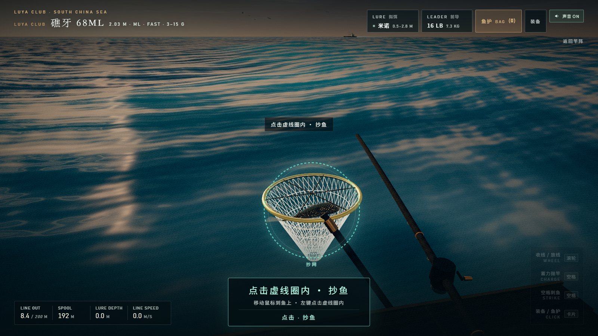
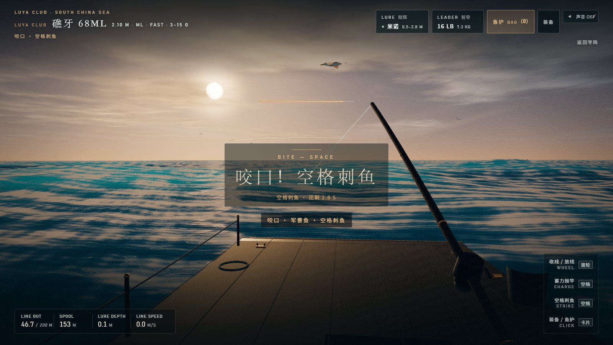
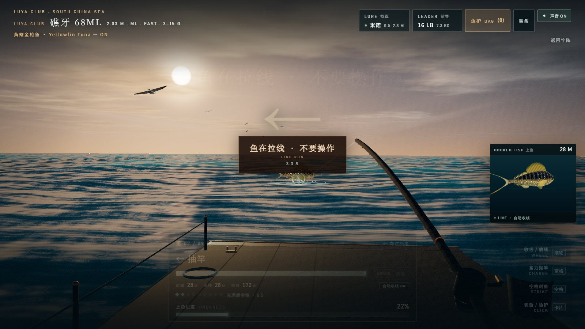
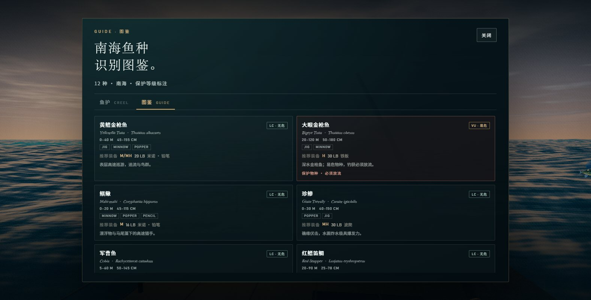
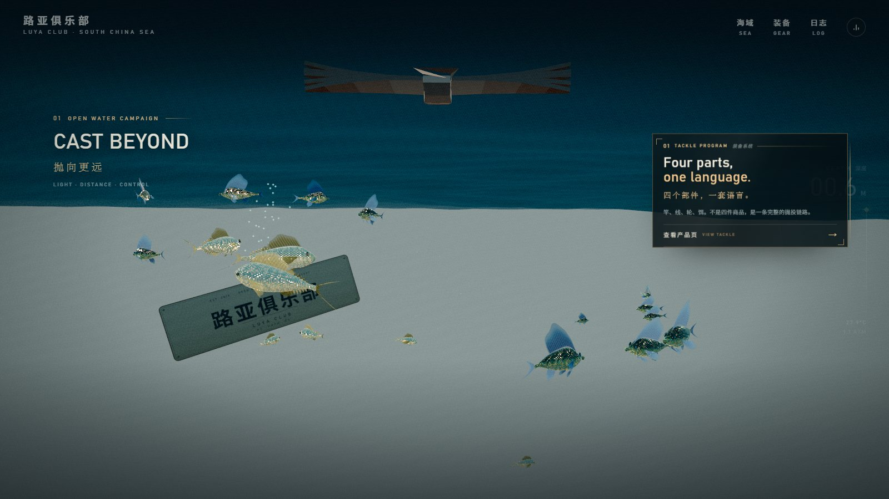
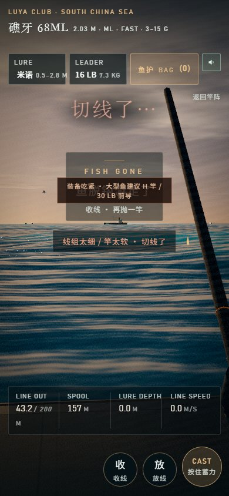
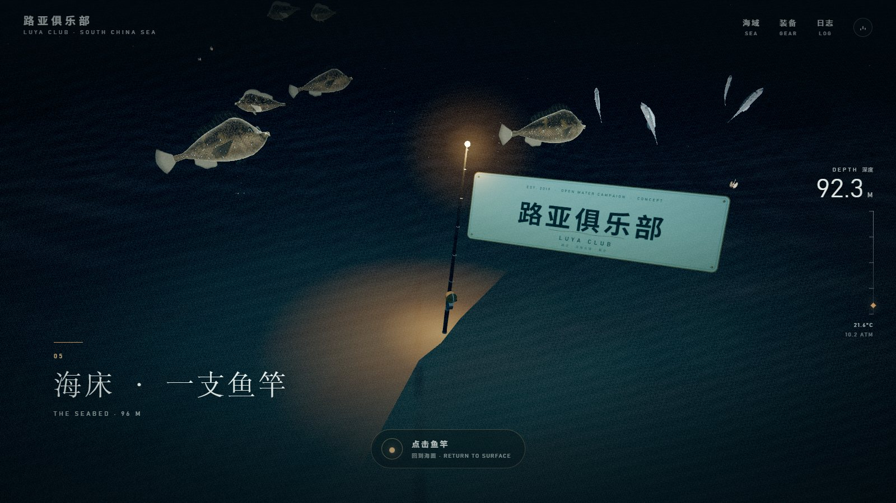

# LUYA CLUB · 路亚俱乐部
🎮 在线试玩：https://nightelfaelora1234.github.io/luya-club/

**A build-free three.js South China Sea dive and first-person lure-fishing experience.**

[English](README.en.md) · [MIT License](LICENSE) · [Contributing](CONTRIBUTING.md) · [Changelog](CHANGELOG.md) · [Third-party notices](THIRD_PARTY_NOTICES.md)



从落日海面下潜到 96 m 海床，跟随漂浮的「路亚俱乐部」招牌穿过透光层、暮光带与无光层；在漂浮栈桥的竿阵选一支概念路亚竿，再用**鼠标左键 / 滚轮 / 空格**完成抛投、收线、刺鱼、搏斗和抄鱼。

全部场景、鱼、拟饵、UI、音效和 90 秒背景音乐都由代码/程序化合成生成；**无构建步骤、无后端、无 API key、无 CDN 运行时依赖**。

## 特性

- **电影化下潜**：Gerstner 海面、天空/云/太阳、Snell window、水下光柱、海雪、鱼群与生物荧光。
- **可点击的企划牌**：下潜途中两块漂浮牌可打开「TACKLE / 装备系统」和「BRAND / 品牌手册」长页；主招牌沿单侧平滑飘落，避让企划牌，最终停在海床鱼竿旁。
- **5 支概念路亚竿**：不同长度、调性、竿力、适饵重和抛投效率；图鉴给出每条鱼的推荐竿/前导/拟饵。
- **5 种程序化拟饵**：米诺、波爬、铁板、软虫、铅笔，带 3D 鱼眼、舌板、分环和三本钩。
- **12 种南海鱼图鉴**：黄鳍/大眼金枪鱼、鲯鳅、珍鲹、军曹鱼、红鳍笛鲷、鞍带石斑、豹纹鳃棘鲈、马鲛、带鱼、鹦嘴鱼、波纹唇鱼；含 IUCN 保护等级和放流规则。
- **有节奏的搏斗**：
  - 小鱼 **6 轮** / 中型 **8 轮** / 大型 **12 轮** QTE；
  - 黄鳍、大眼、军曹鱼、鲯鳅会进入 **LINE RUN** 状态，期间不能操作，线被强行拉出；
  - 线杯 **200 m** 清空即失败；
  - 太大的鱼遇到明显不匹配的竿/线会切线；正确 H 竿 + 30 LB 能扛住 40 kg 鱼。
- **活饵机制已删除**，大型鱼重新可以咬普通拟饵。
- **环境音 + 90 秒循环音乐**：海浪/风/水花/线轮/刺鱼为 WebAudio 合成；背景音乐为 80 BPM 五声音阶合成曲，首尾交叉淡化无缝循环。

| | |
|---|---|
|  |  |
| 咬口只按空格；窗口 2.8–3.4 s | 大型鱼 LINE RUN，期间操作锁定 |
|  |  |
| 图鉴：保护等级 + 推荐竿/线/饵 | 下潜可点击企划牌 |
|  |  |
| 移动端 390×844 | 最终落点：海床鱼竿旁 |

## 快速开始

要求：**Node.js 20+**，支持 **WebGL2** 的浏览器（Chrome / Edge / Safari 近期版本）。

```bash
git clone <your-repo-url> luya-club
cd luya-club
node tools/serve.mjs
```

打开 **http://127.0.0.1:4321/**。没有 `npm install` 步骤，也没有打包。

可选：

```bash
PORT=8080 HOST=0.0.0.0 node tools/serve.mjs
```

低配设备 / GTX 1050 可直接打开：

```text
http://127.0.0.1:4321/?quality=low
```

低档会降 DPR、关闭阴影/AA、减少海面细分、鱼群、粒子和交通；画质档位为 `high / medium / low`，也支持 `?quality=high`。GitHub Pages 可直接部署静态根目录，仓库内已附带 `.github/workflows/pages.yml`。

## 操作

| 输入 | 作用 |
|---|---|
| 按住空格 → 松开 | 蓄力抛竿（最远 120 m） |
| 滚轮上 / 下 | 收线 / 放线（有速率上限） |
| 鼠标 | 摆竿、瞄准；咬口时**只按空格刺鱼** |
| 空格 | 咬口刺鱼、QTE 确认（搏斗中鼠标左右甩动 + 空格） |
| 左键点击虚线圈内 | 抄鱼（圈外无效） |
| 右上卡片 | 装备 / 前导 / 鱼护 / 图鉴 / 声音 |

搏斗时鱼到岸边 6.5 m 会直接起抄网；渔轮只在真正收线时转动。

## 项目结构

```text
index.html                入口 / import map / UI 骨架
css/                      base / shop / fishing / campaign UI
js/core/                  渲染器、状态、质量档
js/world/                 海面、天空、镜头、招牌、海床、鱼、交通、企划牌
js/game/                  竿、拟饵、线组、QTE、搏斗、抄网、鱼护
js/data/                  拟饵、鱼种、图鉴 / 推荐装备
js/ui/                    HUD、字幕、钓鱼 UI、企划长页
js/audio/                 WebAudio 音效 + 90 s 音乐接入
assets/audio/             合成音乐 OGG/MP3
vendor/three/             three.js r186（MIT）
tools/serve.mjs           零依赖本地静态服务器
tools/make-music.py       音乐生成脚本（可选）
docs/screenshots/         README 用的截图
```

## 保护与钓获规则

- **大眼金枪鱼**：IUCN **VU**，钓获后必须放流，KEEP 按钮不可用。
- **鞍带石斑**：IUCN **DD**，大型礁栖鱼，显示“建议放流”，仍允许收入鱼护（不冒充法律保护）。
- **波纹唇鱼**：**EN + CITES II**，仅图鉴科普，不作为路亚目标。
- 其余常见鱼种按 LC 展示。
- 保护规则是游戏内的科普/玩法设计，不替代当地渔业法规。

## 技术说明

- three.js **r186** 本地 vendored，无网络依赖。
- 渲染：ACES tone mapping + 自定义调色；所有模型/贴图程序化。
- 无构建、无框架、无 npm 运行时依赖；`type="module"` + import map。
- 移动端关键 HUD 已适配；低档用于集显/GTX 1050。
- 首次加载会在加载幕布后预编译鱼种/鱼获镜头；后续页面会使用浏览器着色器缓存。

## 音乐重建

```bash
# 需要 numpy 和 ffmpeg；会写出 assets/audio/south-china-sea-90s.wav
python -m pip install -r tools/requirements-music.txt
python tools/make-music.py
ffmpeg -y -i assets/audio/south-china-sea-90s.wav -c:a libvorbis -q:a 5 assets/audio/south-china-sea-90s.ogg
ffmpeg -y -i assets/audio/south-china-sea-90s.wav -c:a libmp3lame -q:a 4 assets/audio/south-china-sea-90s.mp3
```

音频默认静音；点海钓 HUD 的「声音 OFF」变 ON 后音效和音乐一起开始。

## 许可

代码、程序化资产、截图和合成音乐以 **MIT License** 发布。详见 [LICENSE](LICENSE)。three.js 等第三方组件见 [THIRD_PARTY_NOTICES.md](THIRD_PARTY_NOTICES.md)。

“LUYA CLUB / OPEN WATER CAMPAIGN” 为虚构概念品牌，不对应真实厂商。欢迎 fork、换牌和用于自己的路亚内容。
